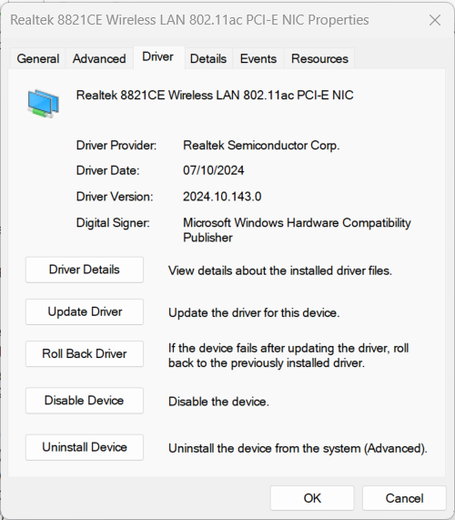
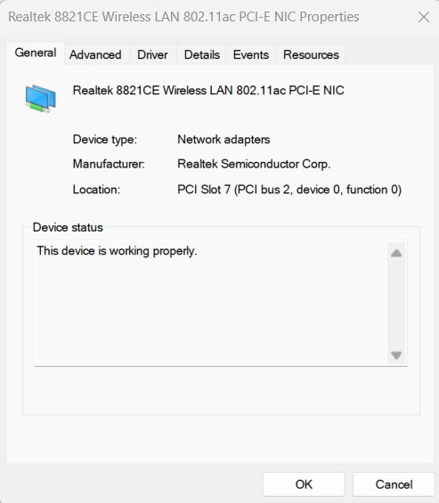

# Звіт з лабораторної роботи №10

**ПІБ:** Мартинюк Софія  
**Група:** КІ-406  
**Варіант:** 16

**Посилання на репозиторій:** https://github.com/martyniuksofiyka/KSN_lab10

## 1–3. Драйвер мережевого адаптера

Для перевірки мережевого адаптера було відкрито Диспетчер пристроїв Windows.

**Назва адаптера:** Realtek 8821CE Wireless LAN 802.11ac PCI-E NIC.

Відомості про драйвер:
- Постачальник: Realtek Semiconductor Corp.
- Дата драйвера: 07.10.2024.
- Версія драйвера: 2024.10.143.0.

Стан пристрою: This device is working properly. Це означає, що адаптер працює належним чином.

## 4. IP-адреса та маска

За допомогою команди `ipconfig /all` було отримано такі параметри Wi-Fi адаптера:

- IPv4-адреса: 192.168.0.102
- Маска підмережі: 255.255.255.0
- Основний шлюз: 192.168.0.1
- DHCP-сервер: 192.168.0.1
- DNS-сервер: 192.168.0.1

Маска підмережі 255.255.255.0 у двійковому вигляді має 24 одиниці та 8 нулів. Тому її префіксна довжина становить /24. Перші 24 біти визначають адресу мережі, а останні 8 бітів використовуються для адресації пристроїв у цій мережі.

## 5. systeminfo

За допомогою команди `systeminfo` отримано інформацію про комп'ютер:

- Ім'я комп'ютера: HEDGEHOG.
- Операційна система: Microsoft Windows 11 Home.
- Версія: 10.0.26200, збірка 26200.
- Виробник: ASUSTeK COMPUTER INC.
- Модель: VivoBook_ASUSLaptop X515EA_X1500EA.
- Тип системи: x64-based PC.
- Обсяг оперативної пам'яті: 16 078 МБ.

*Додати скриншот результату команди systeminfo.*

## 6. Перевірка з'єднання за допомогою ping

Для перевірки мережевого з'єднання було використано команду `ping` з різними параметрами.

**1. Команда `ping -n 4 google.com`**

Було надіслано 4 пакети, усі 4 отримано. Втрат пакетів не було. Середній час відповіді — 19 мс.

**2. Команда `ping -t google.com`**

Було виконано безперервну перевірку з'єднання. Після зупинки команди комбінацією Ctrl+C отримано результат: 8 пакетів надіслано, 6 отримано, 2 втрачено. Відсоток втрат становив 25%.

**3. Команда `ping -l 1000 -n 4 google.com`**

Було надіслано 4 пакети розміром 1000 байтів. Усі пакети отримано, втрат не було. Середній час відповіді — 13 мс.

**4. Команда `ping -a 8.8.8.8 -n 4`**

Було перевірено IP-адресу 8.8.8.8. Команда визначила відповідне доменне ім'я dns.google. Усі 4 пакети отримано, втрат не було. Середній час відповіді — 13 мс.

Отже, з'єднання з мережею загалом працює, хоча під час безперервної перевірки спостерігалися окремі втрати пакетів.

*Додати скриншоти результатів команд ping.*

## 7. Перевірка маршруту за допомогою tracert

Для визначення маршруту проходження пакетів до сервера Google було виконано команду `tracert google.com`.

Було визначено 5 переходів:

1. 192.168.0.1 — локальний маршрутизатор.
2. 46.185.37.253 — вузол провайдера Kyivstar.
3. 142.250.161.237.
4. 142.250.161.236.
5. 142.250.130.100 — сервер Google.

Час проходження до кінцевого вузла становив приблизно 13–14 мс. Маршрут завершився успішно.

*Додати скриншот результату tracert.*

## 8. Перегляд мережевих з'єднань за допомогою netstat

Для перегляду мережевих з'єднань було використано команди:

- `netstat -ano` — відображає активні з'єднання, порти та ідентифікатори процесів (PID).
- `netstat -an` — відображає активні з'єднання та порти в числовому форматі.

У результатах було виявлено TCP- та UDP-з'єднання.

Основні стани TCP:
- LISTENING — порт очікує на підключення.
- ESTABLISHED — з'єднання встановлено.
- TIME_WAIT — з'єднання перебуває на етапі завершення.
- SYN_SENT — комп'ютер намагається встановити з'єднання.

Також було виявлено локальні з'єднання та підключення до зовнішніх серверів через порт 443.

*Додати скриншоти результатів netstat -ano та netstat -an.*

## 9–11. Створення та виконання Bash-скрипту lab.sh

У межах роботи було створено Bash-скрипт `lab.sh`, який виконує такі завдання:

- створює каталог із прізвищем та підкаталоги DEE, SEE, SSS;
- створює текстові файли з ім'ям та прізвищем;
- записує до файлів електронну пошту, назву групи та дату виконання;
- копіює створені файли до кореневого каталогу;
- перевіряє правильність електронної пошти за допомогою регулярного виразу.

Після виконання скрипту перевірка електронної пошти завершилася успішно.

Результат перевірки структури каталогів та файлів відповідає вимогам лабораторної роботи.

*Додати скриншот дерева каталогів `tree Martyniuk` та результат виконання `bash lab.sh`.*

## 12. Завантаження роботи на GitHub

Створений репозиторій: https://github.com/martyniuksofiyka/KSN_lab10

Файли лабораторної роботи було завантажено до репозиторію GitHub. Також було виконано локальну перевірку за допомогою команди `bash tests/check.sh`.

Усі 13 перевірок завершилися успішно.

*Додати скриншот GitHub Actions із зеленою позначкою успішного виконання, якщо перевірка завершилася успішно.*

## 13. Пошук помилок 404 в Apache-логах

Для пошуку помилок 404 було використано Bash-скрипт, який аналізує файл Apache-логу.

Результат виконання:

**Кількість 404: 1**

Знайдено один запис із кодом відповіді HTTP 404. Він стосується запиту до ресурсу `/favicon.ico`.

Отже, у наданому файлі журналу було виявлено одну помилку 404.

*Додати скриншот результату виконання скрипту з кількістю помилок 404.*

## Висновок

Під час виконання лабораторної роботи було закріплено навички роботи з командним рядком Windows та оболонкою Bash у Linux. Було перевірено параметри мережевого адаптера, IP-адресу, маску підмережі та стан мережевого з'єднання за допомогою команд ping, tracert і netstat. Також було створено Bash-скрипт для роботи з каталогами та файлами, перевірки електронної пошти й пошуку помилок 404 в Apache-логах. Скрипт пройшов усі 13 локальних перевірок. Отримані результати підтверджують виконання основних завдань лабораторної роботи.
